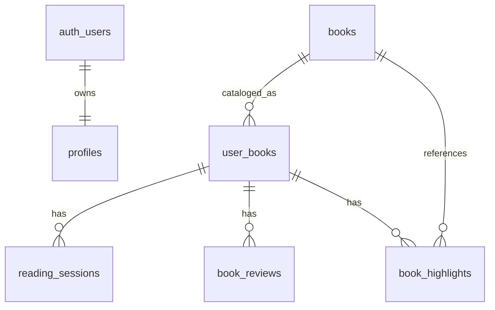

<div align="center">
  
</div>

<h1 align="center">Iahbrary</h1>

<p align="center">
  <strong>A reading tracker that treats reading like training.</strong><br />
  Live sessions, real pace, a personal library, and a calm liquid-glass interface.
</p>

<p align="center">
  
  
  
  
</p>

> **Status:** this is the sanitized public showcase copy of a private project.
> The original Supabase project is offline, so this repository does not point at
> a live backend. Screenshots and a short demo video are being prepared.

## Why I built it

Most reading apps are digital shelves. I wanted one that felt closer to a running
app: start a timed session, log the pages, watch your pace, and get a small
reward when you finish. The interface borrows the soft, borderless language of
Apple's liquid-glass design, but the interesting part is underneath it: a clean
multi-user schema, owner-only Row Level Security, and an offline queue that keeps
sessions safe when the network drops.

This repo is the public engineering copy. Account data, deployment credentials,
internal notes, and the original production history stay private.

## What it does

- **Timed reading sessions** with start/end pages, notes, and automatic page math.
- **Pace tracking** for the last session, the whole book, and the session you are
  logging right now.
- **A personal library** with `Want to read`, `Reading`, and `Finished` states.
- **A curated catalog and search** for finding the next book.
- **Reviews and ratings** when a book is finished.
- **Highlights** stored locally first, then synced when possible.
- **Reading stats** including streaks, daily goals, and a weekly chart.
- **Shareable reading stickers** that turn a session into a visual recap.
- **Offline session queue** so a dropped connection does not lose a session.
- **Account deletion** that removes the user's rows and auth account in one
  transaction.

## Engineering highlights

### 1. A four-way data model instead of one giant table

The first prototype stored catalog metadata and one user's progress in the same
`books` table. That works for a single reader and breaks immediately for two.
The public version separates the concerns:

| Table | Responsibility |
| --- | --- |
| `books` | Shared bibliographic catalog |
| `user_books` | One reader's relationship with a book (status, progress, dates) |
| `reading_sessions` | Discrete reading events and pace data |
| `book_reviews` | A reader's rating and reflection |
| `book_highlights` | A reader's saved quotes and notes |
| `profiles` | Display name only; no email copy |



The app talks to the database through small repositories in
`src/db/repositories/`. The UI never writes SQL directly, and every personal
query is scoped by the signed-in user.

### 2. Row Level Security is the boundary, not the UI

The client is allowed to be curious. The database is not allowed to answer.

- Every personal table is owner-scoped with `auth.uid()`.
- `reading_sessions` and `book_reviews` derive ownership from their parent
  `user_books` row.
- `profiles` is readable only by its owner. The email column was removed
  entirely; Supabase Auth owns the login email.
- The shared catalog is public to read and authenticated-insert-only. Clients
  cannot update or delete catalog rows.
- Username availability goes through a narrow `SECURITY DEFINER` RPC that
  returns a boolean, not a profile row.
- Account deletion goes through one transactional `SECURITY DEFINER` RPC that
  can only ever target `auth.uid()`.

| Table | Read | Insert / update / delete |
| --- | --- | --- |
| `books` | Anyone | Authenticated insert only; no client update or delete |
| `user_books` | Owner | Owner |
| `reading_sessions` | Owner via `user_books` | Owner via `user_books` |
| `book_reviews` | Owner via `user_books` | Owner via `user_books` |
| `book_highlights` | Owner | Owner |
| `profiles` | Owner | Owner; created by an auth trigger at signup |
| `auth.users` | Supabase-managed | Supabase-managed |

The full threat model and manual test checklist are in
[docs/security.md](docs/security.md). The schema and request flow are in
[docs/architecture.md](docs/architecture.md).

### 3. No username-to-email lookup

The prototype let someone type a username and resolved it to an email through a
public `profiles` table. That made emails enumerable. The public version:

- signs in with **email + password**;
- treats the username as a display name only;
- creates the profile from auth metadata in a database trigger, in the same
  transaction as the auth user;
- keeps the unique lower-case username index as the final guard against races.

The result is a login flow that does not need a public email directory.

### 4. Offline-first session capture

`src/services/offlineQueue.ts` writes unsent sessions to AsyncStorage. When a
session insert fails, the session is queued; the next successful insert flushes
the queue. Because a queued session still belongs to a `user_books` row, the same
RLS rules apply when it finally reaches Postgres.

### 5. Account deletion as one transaction

Instead of asking the client to delete five tables in the right order, the
database exposes `delete_own_account()`. It deletes highlights, reviews,
sessions, library rows, the profile, and the auth user inside one transaction.
The client only needs permission to call that one function.

## Tech stack

- **Expo 57 / React Native 0.86 / React 19** — one codebase for iOS, Android, web
- **TypeScript (strict)** — shared types for books, sessions, reviews, and stats
- **Expo Router** — file-based navigation with a custom liquid-glass tab bar
- **Supabase Auth + Postgres + RLS** — identity, data, and the security boundary
- **AsyncStorage** — offline sessions and local highlight fallback
- **expo-blur, expo-haptics, expo-image, expo-audio** — the interface details
- **GitHub Actions** — manual unsigned iOS IPA build for sideloading

## Run it locally

### Prerequisites

- Node.js 20.6+ (the catalog script uses `--env-file`)
- A Supabase project
- Expo Go, an iOS/Android simulator, or a browser

### 1. Create the database

Link the Supabase CLI and push the migrations:

```bash
npx supabase link --project-ref <your-project-ref>
npx supabase db push
```

Or open `supabase/migrations/` and run the files in filename order in the
Supabase SQL editor. `20260915_initial_schema.sql` is the base schema; the later
migrations add the four-way model, profiles, and the hardened RLS policies.

### 2. Configure Auth

- Enable the **Email** provider.
- Add `iahbrary://` as an allowed redirect URL.
- For a local demo, you can disable **Confirm email** so signup returns a session
  immediately. With confirmation on, the confirmation link returns through the
  `iahbrary://` deep link.

### 3. Add environment variables

```bash
cp .env.example .env
```

Fill in the project URL and publishable/anon key:

```dotenv
EXPO_PUBLIC_SUPABASE_URL=https://your-project.supabase.co
EXPO_PUBLIC_SUPABASE_ANON_KEY=your-publishable-or-anon-key
```

The anon key is designed to be public. The service-role key is not.

### 4. Install and run

```bash
npm install
npm start
```

For the web build:

```bash
npm run web
```

### 5. Seed the shared catalog (optional)

The catalog seeder needs a server-side service-role key because the client is
not allowed to update the shared catalog. Add these lines to your local `.env`:

```dotenv
SUPABASE_URL=https://your-project.supabase.co
SUPABASE_SERVICE_ROLE_KEY=your-service-role-key
```

Then run:

```bash
npm run sync:books
```

The script reads `src/constants/curatedBooks.ts`, inserts missing books, and
never overwrites a book that already exists. The service-role key stays in your
local environment; the app bundle only ever receives the `EXPO_PUBLIC_` values.

### 6. Type-check

```bash
npm run typecheck
```

## Repository layout

```text
.
├── src/
│   ├── app/                  # Expo Router screens and root layout
│   ├── components/           # Reading, library, stats, and UI components
│   ├── constants/            # Curated catalog and design tokens
│   ├── context/              # Auth provider
│   ├── db/repositories/      # Supabase data access
│   ├── hooks/                # Timer and theme hooks
│   ├── screens/              # Auth screen
│   ├── services/             # Supabase client, search, offline queue, audio
│   └── types/                # Shared TypeScript models
├── supabase/migrations/      # Reproducible schema + RLS hardening
├── scripts/                  # Catalog sync and data helpers
├── docs/                     # Architecture, security, and brand assets
├── .github/workflows/        # Manual unsigned iOS build
└── app.json                  # Expo configuration
```

## What is verified in this repo

- `npm run typecheck` passes.
- `npm run build:web` succeeds.
- The exported web bundle contains only the `EXPO_PUBLIC_` client key supplied at
  build time; no service-role key or original project URL is present.
- The public tree contains no hardcoded Supabase project URL, real publishable
  key, service-role key, personal email, or absolute local path.
- The migration chain is ordered from an empty base schema to owner-only
  policies and a deny-by-default RLS posture. It has been reviewed statically but
  not executed against a hosted Supabase project in this public copy.
- No production data or private repository history is included.

The original Supabase project is offline, so I cannot claim a live end-to-end
deployment from this public copy. The manual RLS checklist in
[docs/security.md](docs/security.md) is the next verification step once a fresh
project is online.

## Known limitations

- The original backend is offline. This repo is a code and architecture
  showcase, not a hosted product.
- The app icon is still Expo's template placeholder; it should be replaced
  before any store or portfolio screenshot pass.
- The four short ambient loops in `assets/audio/` are demo assets from the
  original project. They are optional; replace them with licensed audio if you
  reuse the app.
- RLS is covered by a manual checklist rather than an automated pgTAP suite.
- The username availability RPC reveals whether a display name is taken. That is
  necessary for signup and exposes no email or account data.
- The iOS workflow produces an **unsigned** IPA for sideloading; it is not a
  signed App Store build.

## License

MIT © 2026 Adrian Alexander P. Medina. See [LICENSE](LICENSE).
