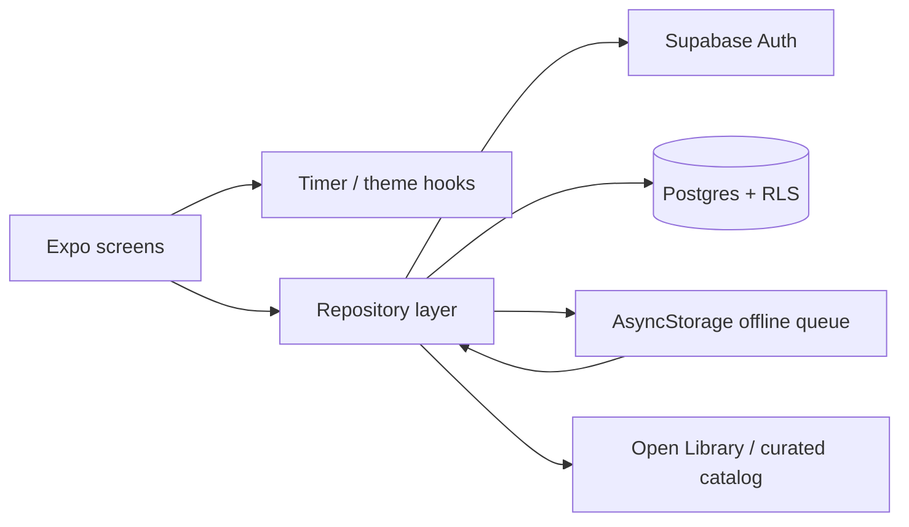
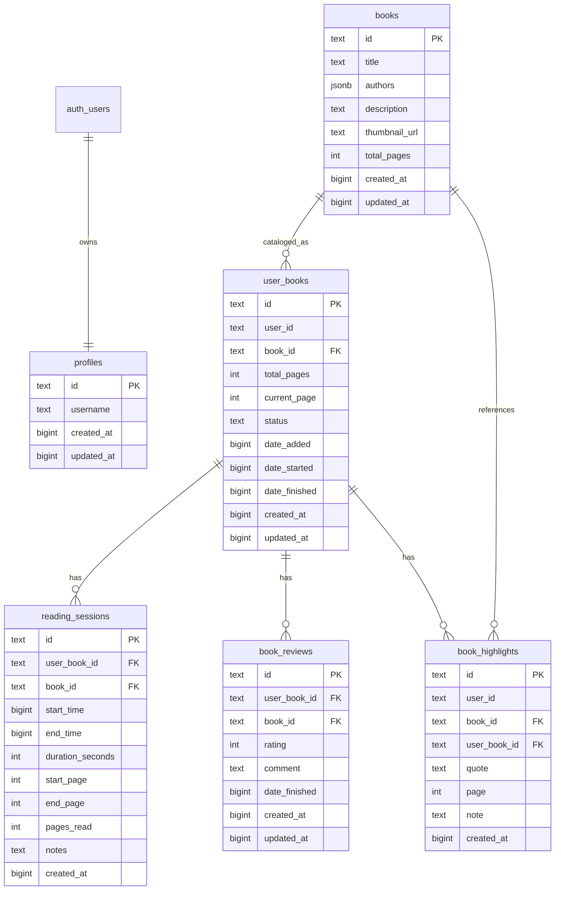
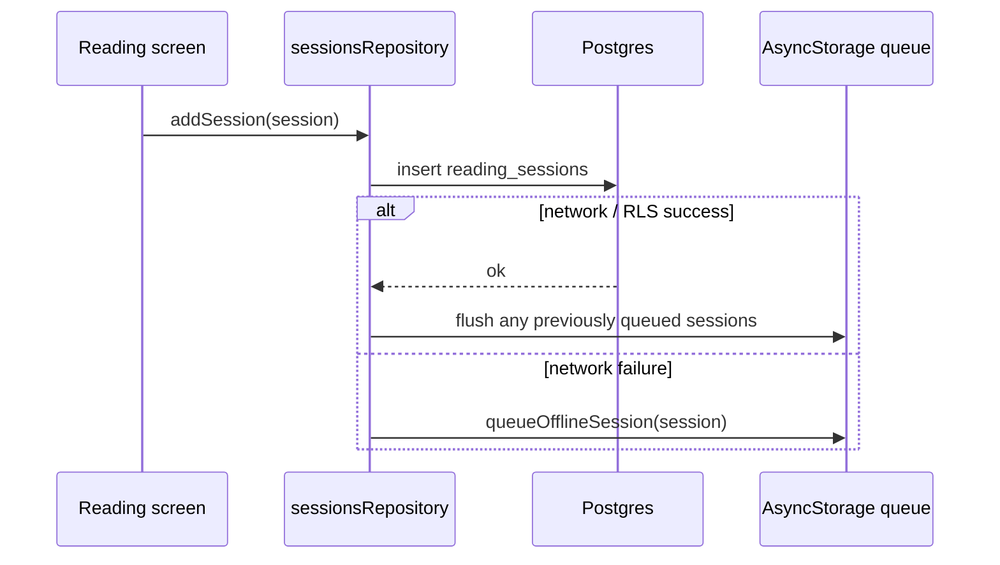

# Architecture

Iahbrary is deliberately small: an Expo client, a repository layer, and
Supabase for identity and persistence. The interesting decisions are about
ownership and failure modes, not about adding more services.

## Request flow

- Screens never call `supabase.from(...)` directly.
- Repositories translate snake_case rows into the domain types in
  `src/types/index.ts`.
- The offline queue is a write-behind buffer for reading sessions. It never
  becomes a second source of truth; Postgres still owns the final record.

## Data model

### Why the catalog and the library are separate

`books` is a shared bibliographic catalog. `user_books` is the reader's copy:
status, current page, and start/finish dates. A catalog row can be read by
everyone, while the library row is private. This prevents one reader's progress
from changing what another reader sees.

### Why sessions point at `user_books`

A session needs to know which reading attempt it belongs to, not just which book
was read. A reader can finish a book, start it again, or keep two editions. The
`user_book_id` foreign key keeps pace and history attached to the right attempt.

### Timestamps

The client stores millisecond timestamps as `BIGINT`. That keeps the JS boundary
simple and avoids timezone ambiguity in the first version. A production rewrite
could move to `timestamptz` for server-side analytics; the current schema is
optimized for an offline-first client.

## Signup and profile creation

1. The client validates the username format and calls the
   `is_username_available` RPC.
2. `supabase.auth.signUp` creates the `auth.users` row with the username in
   `raw_user_meta_data`.
3. The `iahbrary_on_auth_user_created` trigger inserts the matching
   `profiles` row in the same transaction.
4. If the username violates the unique lower-case index, the trigger raises and
   the auth signup is rolled back.
5. Once a session exists, the client reads its own profile through owner-only
   RLS and uses it as the display name.

The client does not look up another user's profile or email at any point.

## Login

Login is email + password. A username is **not** a login identifier. This is a
deliberate tradeoff:

- the prototype's username -> email lookup required a public profile table and
  leaked email addresses;
- email login is less magical, but it removes an entire account-enumeration
  surface.

## Offline sessions

The queue stores the full session payload, including `userBookId`. When it is
flushed, the same insert path and RLS checks apply. A queued session cannot be
replayed into another user's library because the parent `user_books` row must
belong to the signed-in user.

## Catalog seeding

The catalog is shared and clients cannot update it. Missing books are inserted
by `scripts/sync-supabase.mjs` using a service-role key that exists only in the
developer's local environment. The app's `addBook` path uses
`INSERT ... ON CONFLICT DO NOTHING`, so a reader can add a missing search result
without overwriting a catalog row that another reader already uses.

## Failure modes and choices

| Failure | Choice |
| --- | --- |
| Network drops while logging a session | Queue locally, retry on the next successful insert |
| Username taken during signup | Unique index + trigger rollback; pre-check is only UX |
| Profile missing for an older account | Signed-in fallback creates the caller's own profile |
| User deletes account | One transactional function removes app rows and the auth user |
| Shared catalog gets polluted | Clients can insert but cannot update or delete; add moderation later |
| Supabase project is unavailable | The app shows empty repositories rather than crashing; a real deployment needs explicit error states |

## What I would change for a larger product

- Move timestamps to `timestamptz` and use server-side aggregates for stats.
- Add pgTAP tests for every policy and a CI job that runs them against a local
  Supabase stack.
- Add a moderation queue for catalog inserts.
- Move account deletion behind an Edge Function if the target project's
  `auth.users` permissions differ from the default Supabase role.
- Add pagination and a cached catalog layer before the catalog grows beyond a
  few hundred books.
